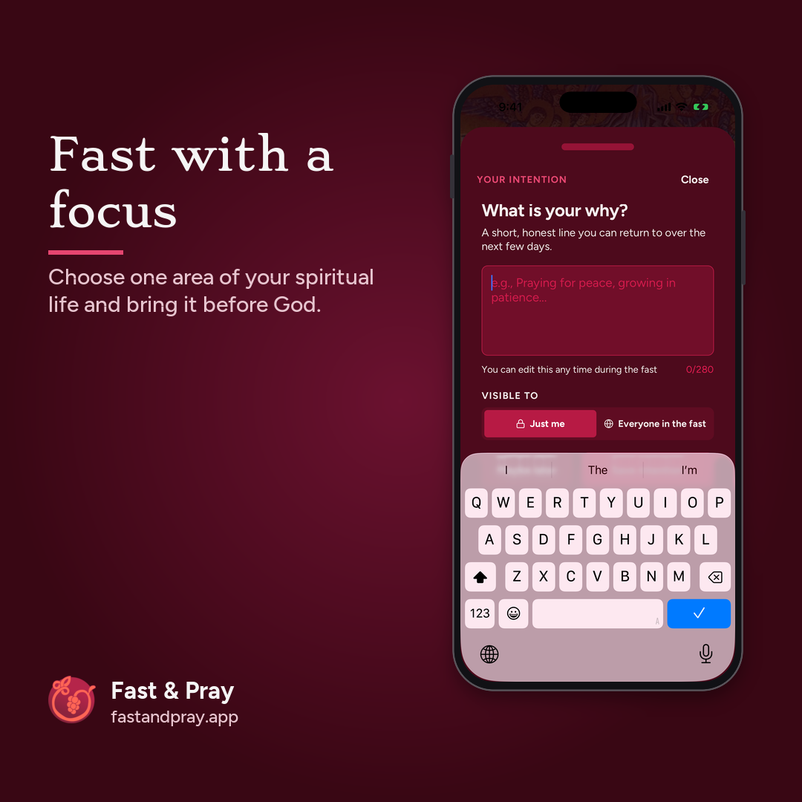
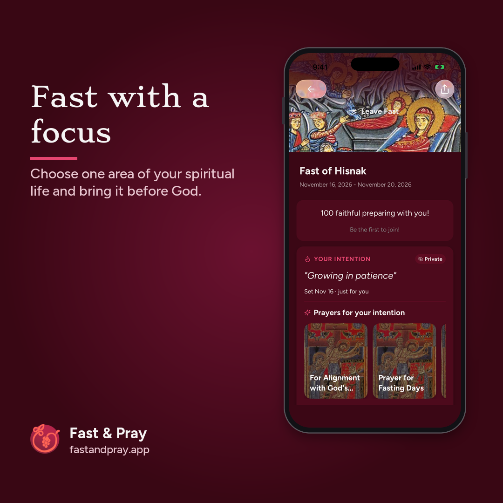

A fast changes us most when it has a focus. Not eating certain foods is a discipline; a fast with an intention becomes a penance.

## One area, held before God
To make a fast penitential, we focus our intention on one area of our spiritual life. We let it become the focal point of our reflection and prayer. Through the weeks of the fast we explore it before God, and ask for his guidance in aligning that area of our lives with him.

Choose one. Depth comes from staying with a single thing rather than spreading thin.

## A private intention
Setting an intention privately is a very powerful gesture. It is between you and God.

## A shared intention
Sharing it with others can hold us accountable. That is an option, not an expectation: share it if it helps you keep faith with what you set out to do.

## In the app
When you join a fast, Fast & Pray asks, "What is your why?" Write a short line, up to 280 characters. Under "Visible to", choose **Just me** (private, the default) or **Everyone in the fast**. You can skip with "Maybe later" and add one later, and you can edit it, make it private or public, or clear it at any time. Join us at fastandpray.app.

