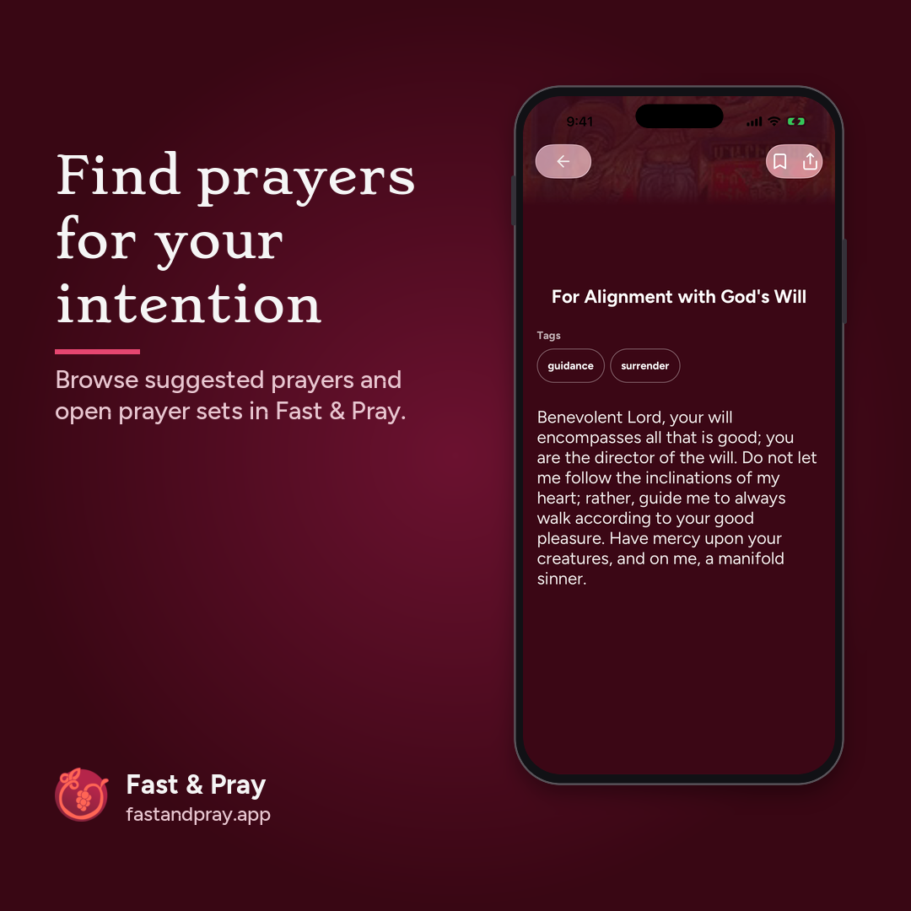
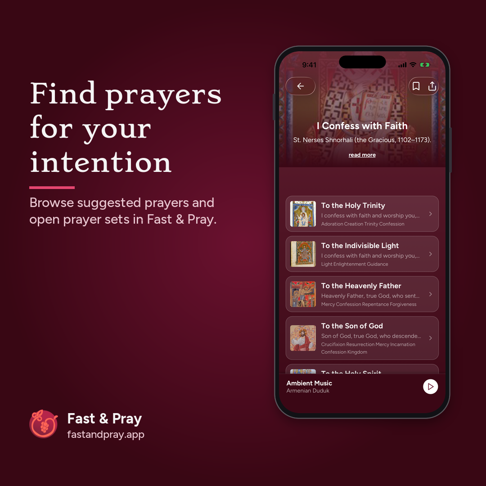

We fast and pray for something: a loved one, a burden, a thanksgiving. Once you have named what you are fasting for, Fast & Pray can help you find prayers to carry it to God.

## What's new
- When you have set an intention for a fast you have joined, Fast & Pray suggests prayers under the heading **Prayers for your intention**.
- Tap any suggestion to open the prayer and read it in full.
- Prayer sets now show a short preview of their description, with **Read more** opening the full description, so you know what a set is before you begin.

## Where you'll see them
- On the fast's own page, inside your intention card (up to five prayers).
- On the Morning Prayers and Evening Prayers checklist pages, under a short reminder of your intention (up to three prayers).
- Not on the Home screen. You need to be signed in and to have joined the fast.

They are suggestions only, and you choose which to pray.

<video src="/blog/find-prayers-for-your-intention/clip.mp4" controls muted playsinline loop style="max-width:100%"></video>

To read more about why an intention matters, see *Fast with a focus*. You are welcome to join us at fastandpray.app.
