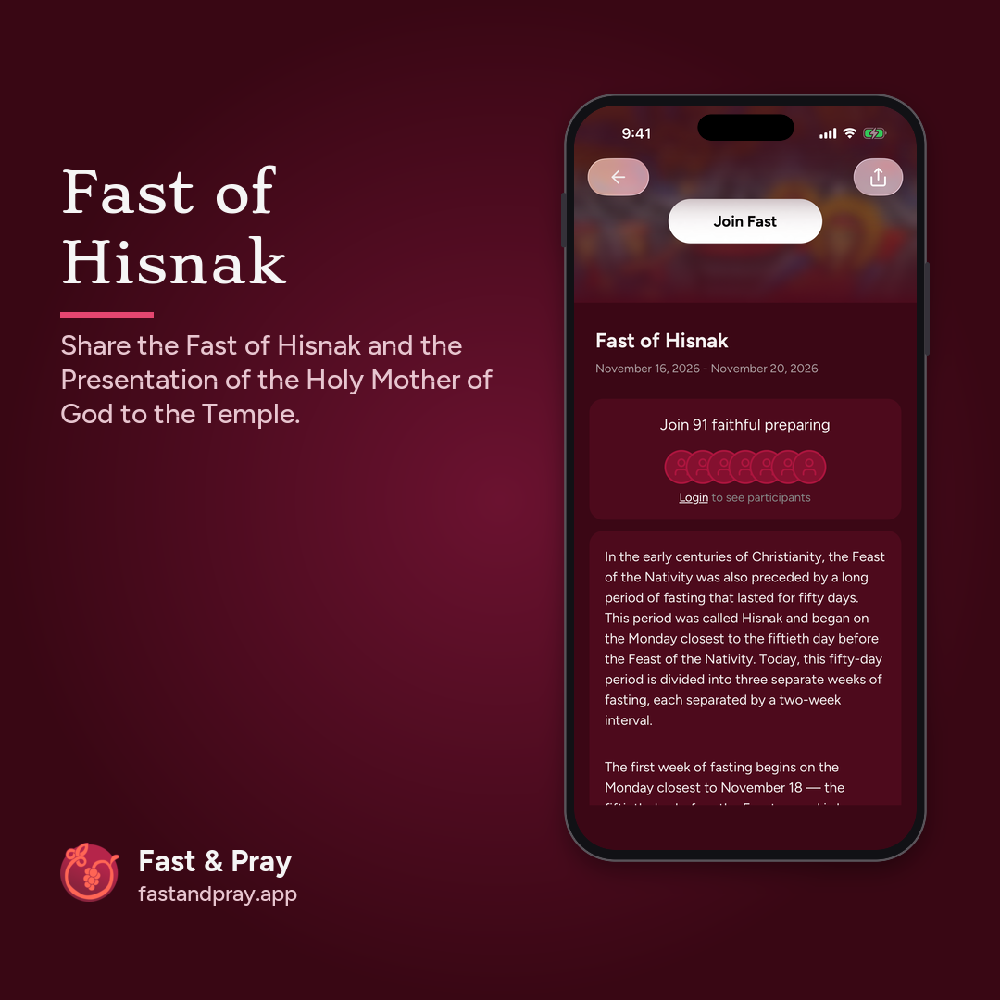
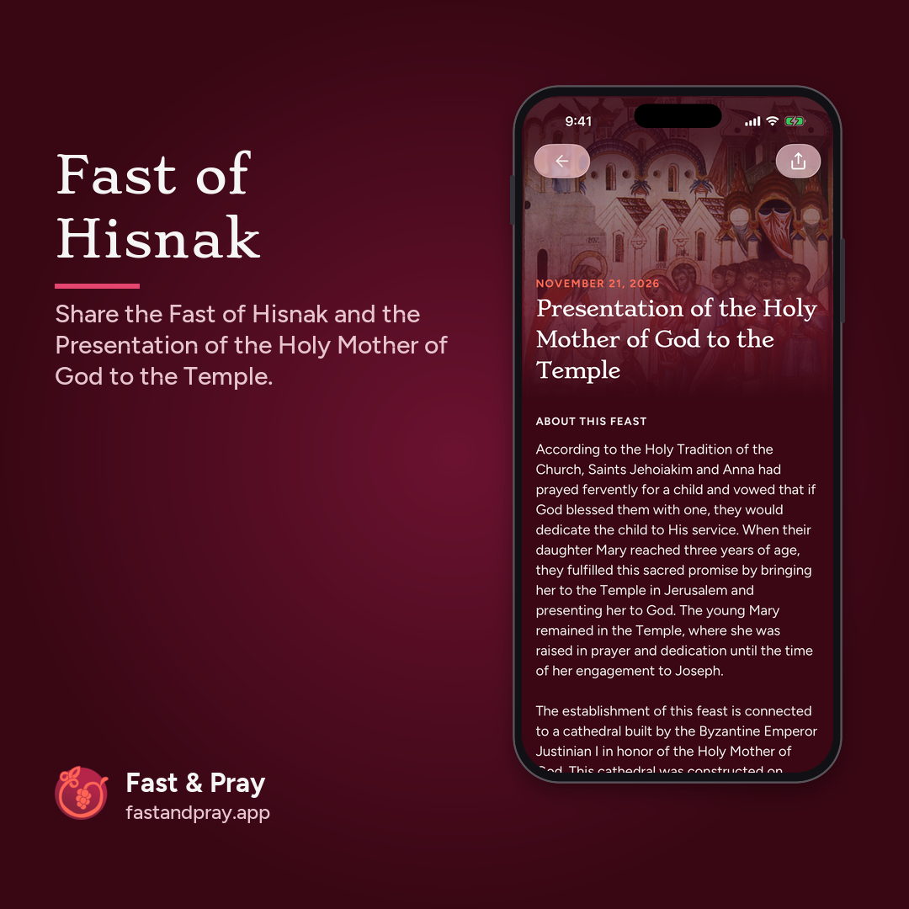

Fasting is personal, but it was never meant to be lonely. Fast & Pray can now turn a fast or a feast into an image you can share.

## What's new
- Open a fast or a feast and tap the share button. For a fast, choose **Create a shareable image**, then **Share image**. **Share link** is still there too.
- Pick a **Story** (1080 × 1920), **Post** (1080 × 1350) or **Square** (1080 × 1080) layout and see a preview first.
- The image carries the name of the fast or feast, its dates, its artwork and the Fast & Pray name with web.fastandpray.app. Then you choose where it goes, such as Instagram or Facebook.
- On the web version of the app, sharing stays a link.

## Why it matters
When one person shares, family and friends see an invitation. Encourage someone to fast alongside you this season.

<video src="/blog/share-your-fast/clip.mp4" controls muted playsinline loop style="max-width:100%"></video>

Join us at fastandpray.app.
